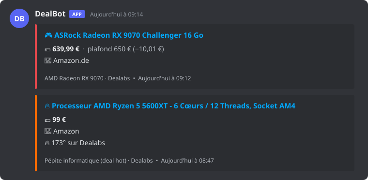

<div align="center">

# 🛒 DealBot Hardware Components

**Reçois sur Discord les bons plans Dealabs dès qu'un composant PC passe sous TON prix.**

[](https://github.com/Ummaaar/DealBotHardwareComponents/actions/workflows/dealbot.yml)


[](LICENSE)



<sub>Exemple d'alertes : une cible sous son prix plafond, et une « pépite » devenue hot sur Dealabs.</sub>

</div>

---

## Pourquoi ce bot ?

Avec la pénurie de mémoire, les prix des composants bougent tous les jours et les vrais bons plans
partent en quelques heures. Surveiller Dealabs à la main, c'est rater la moitié des affaires.

DealBot le fait pour toi, **gratuitement et sans serveur** :

- 🎯 **Tes prix, pas ceux des autres** : chaque composant a son prix plafond. Une RX 9070 à 640 € ? Alerte. À 820 € ? Silence.
- 🔥 **Les pépites en bonus** : tout deal informatique qui devient « hot » sur Dealabs te remonte aussi, même hors de ta liste.
- 🧠 **48 cibles prêtes à l'emploi** : cartes graphiques, processeurs AM4/AM5/Intel, RAM, SSD, disques NAS, cartes mères, alimentations, refroidissement, boîtiers, écrans, périphériques, réseau et homelab.
- 💻 **PC portables toutes marques** : gamers classés par carte graphique (RTX 4050 à 5080), polyvalents fluides (16 Go, Ryzen 5/7, Core i5/i7/Ultra), haut de gamme OLED ou 32 Go, et MacBook Air.
- 🧹 **Zéro bruit** : PC fixes complets, consoles, Chromebooks, accessoires et RAM de portable sont filtrés, et la « RTX 5070 » d'un portable ne se fait pas passer pour une carte graphique. Chaque deal n'est notifié qu'une fois.
- ☁️ **Aucun serveur** : tourne sur GitHub Actions toutes les 15 minutes (déclenché par cron-job.org), même PC éteint.
- 🩺 **Il se surveille tout seul** : s'il ne peut plus lire Dealabs, il te prévient sur Discord avec la marche à suivre, puis quand tout est rétabli.
- ⚡ **Installation en une commande** sur Windows.

## Installation express (Windows, ~5 min)

**1. Crée le webhook Discord**

Clic droit sur ton salon → **Modifier le salon** → **Intégrations** → **Webhooks** → **Nouveau webhook** → **Copier l'URL du webhook**.

> ⚠️ Cette URL est un secret : toute personne qui l'a peut poster dans ton salon. Ne la mets jamais dans le code.

**2. Récupère le projet**

En haut de cette page : **Code** → **Download ZIP**, puis décompresse-le. Ou, si Git est installé :

```powershell
git clone https://github.com/Ummaaar/DealBotHardwareComponents.git
cd DealBotHardwareComponents
```

**3. Lance l'installation**

```powershell
powershell -ExecutionPolicy Bypass -File .\setup.ps1
```

Le script installe ce qui manque (Git, GitHub CLI, Python via winget), te connecte à GitHub,
teste ton webhook, crée **ton propre dépôt**, y enregistre le webhook en secret et lance le
premier passage. Options : `-RepoName mon-dealbot`, `-Private`.

**4. Rends le déclenchement fiable avec cron-job.org (recommandé, 5 min, gratuit)**

La planification intégrée de GitHub (`schedule`) n'est **pas garantie** : sur un dépôt neuf, elle
peut mettre des heures à démarrer, et GitHub saute des passages quand ses serveurs sont chargés.
Un service de cron externe qui appelle l'API GitHub toutes les 15 minutes règle le problème.
La planification GitHub reste active en secours, et l'anti-doublon évite toute alerte en double.

1. Crée un jeton GitHub **limité à ton dépôt** :
   [github.com/settings/personal-access-tokens/new](https://github.com/settings/personal-access-tokens/new)
   - *Expiration* : 1 an (note-toi la date pour le renouveler)
   - *Repository access* : **Only select repositories** → ton dépôt DealBot
   - *Permissions* → *Repository permissions* → **Actions : Read and write** (rien d'autre)
   - **Generate token** et copie-le (`github_pat_...`). Ce jeton peut seulement lancer le bot.
2. Crée un compte gratuit sur [cron-job.org](https://cron-job.org), puis **Create cronjob** :

   | Champ | Valeur |
   |---|---|
   | URL | `https://api.github.com/repos/TON-PSEUDO/TON-DEPOT/actions/workflows/dealbot.yml/dispatches` |
   | Planification | toutes les 15 minutes |
   | *Advanced* → Méthode | `POST` |
   | *Advanced* → En-tête `Authorization` | `Bearer github_pat_...` (espace après `Bearer`) |
   | *Advanced* → En-tête `Accept` | `application/vnd.github+json` |
   | *Advanced* → En-tête `User-Agent` | `cron-dealbot` |
   | *Advanced* → Corps | `{"ref":"main"}` |

3. **Test run** : la réponse doit être **204 No Content** (401 = jeton mal collé, 404 = URL ou
   accès au dépôt, 422 = corps manquant). Puis **Créer**.

> `setup.ps1` affiche ces valeurs déjà remplies pour ton dépôt à la fin de l'installation.
> Ne publie jamais une capture où ton jeton est visible.

C'est tout : le bot tourne ensuite tout seul toutes les 15 minutes.

<details>
<summary><b>Installation manuelle (Linux, macOS, ou sans le script)</b></summary>

```bash
git clone https://github.com/Ummaaar/DealBotHardwareComponents.git dealbot && cd dealbot
git remote rename origin upstream
gh repo create mon-dealbot --public --source=. --remote=origin --push
gh secret set DISCORD_WEBHOOK_URL          # colle l'URL du webhook
gh workflow run dealbot.yml
```

Sans GitHub CLI : crée un dépôt public sur github.com, pousse le code, puis ajoute le secret dans
**Settings → Secrets and variables → Actions → New repository secret** (`DISCORD_WEBHOOK_URL`),
et lance **Actions → DealBot → Run workflow**.

Un dépôt **public** a des minutes GitHub Actions illimitées. En privé (~2 000 min/mois),
passe le cron à `*/30` dans `.github/workflows/dealbot.yml`.
</details>

## Comment ça marche

```
 cron-job.org ─(15 min)─▶ GitHub Actions          (planification GitHub en secours)
                               │
                               ▼
 Dealabs RSS (new + hot) ─▶ ┌──────────────┐   prix ≤ plafond    ┌──────────┐
                            │   bot.py     │ ──────────────────▶ │ Discord  │
                            │  filtres +   │   ou deal "hot"     │ webhook  │
                            │  anti-doublon│                     └──────────┘
                            └──────┬───────┘
                                   │ état (deals déjà notifiés)
                                   ▼
                          cache GitHub Actions
```

- Le bot lit uniquement les **flux RSS publics** de Dealabs (2 requêtes par passage) : pas d'extraction de pages, pas de compte.
- Le prix vient du marchand indiqué dans le flux, avec repli sur le prix écrit dans le titre.
- Au **premier lancement**, il mémorise les deals déjà en ligne sans les envoyer, pour ne pas inonder ton salon.

## Personnaliser tes cibles

Tout se passe dans [`config.yaml`](config.yaml), puis `git commit` et `git push`.

```yaml
  - name: AMD Radeon RX 9070
    category: gpu            # gpu cpu ram ssd hdd mobo psu cooling case screen periph network homelab laptop
    max_price: 650           # alerte si prix ≤ 650 €
    min_price: 300           # ignore les accessoires (backplate, support GPU…)
    include: ['\brx ?9070\b(?! ?(xt|gre)\b)']   # au moins un motif doit correspondre
    require: []              # TOUS ces motifs doivent correspondre (ex : capacité 16 Go)
    exclude: []              # un seul suffit à ignorer le deal
```

Pour une cible **PC portable**, ajoute `kind: laptop` : elle ne regardera que les deals reconnus comme
portables (liste `laptop_patterns`), et les cibles composants ignoreront ces deals.

Les motifs sont des regex appliquées au titre **normalisé** : minuscules, sans accents,
tirets remplacés par des espaces (`Écran RX-9070` → `ecran rx 9070`).

Réglages utiles dans `settings` et `pepites` :

| Option | Effet |
|---|---|
| `mention: "@here"` | notification forte sur ton téléphone |
| `notify_on_first_run: true` | envoie aussi les deals déjà en ligne au premier lancement |
| `pepites.min_temperature: 300` | ne garde que les pépites très bien notées |
| `pepites.enabled: false` | désactive les pépites |

Tester une modification sans rien envoyer :

```bash
pip install -r requirements.txt
python bot.py --dry-run -v
```

## Option : héberger sur ton homelab ou un VPS

Même script, vérification toutes les 10 minutes, en continu :

```bash
echo 'DISCORD_WEBHOOK_URL=https://discord.com/api/webhooks/...' > .env
chmod 600 .env
docker compose up -d --build
docker compose logs -f
```

`config.yaml` est monté en lecture seule : modifie-le puis `docker compose restart`.

## Dépannage

| Symptôme | Cause / solution |
|---|---|
| Message « ⚠️ DealBot a besoin de toi » | Le bot ne lit plus Dealabs depuis ~45 min. Si l'erreur est 403/429, Dealabs bloque GitHub : passe sur l'hébergement Docker. |
| Aucun run automatique dans Actions | La planification GitHub n'est pas fiable : mets en place cron-job.org (étape 4). Les runs déclenchés par cron-job.org apparaissent comme `workflow_dispatch`. |
| cron-job.org renvoie 401 | Jeton expiré ou mal collé : régénère-le et remets `Bearer github_pat_...`. |
| Retard de quelques minutes | Normal : le cron GitHub n'est pas précis aux heures chargées. |
| Une alerte manque | Lance `python bot.py --dry-run -v` pour voir les deals ignorés (prix illisible, filtre trop strict). |
| Fausse alerte | Ajoute un motif dans `exclude` de la cible, ou dans `global_exclude`. |

## Structure

```
├── bot.py                         # le bot (Python 3.10+, stdlib + PyYAML)
├── config.yaml                    # cibles, prix plafonds, filtres
├── setup.ps1                      # installation automatique (Windows)
├── .github/workflows/dealbot.yml  # exécution toutes les 15 min + keepalive
├── Dockerfile, docker-compose.yml # hébergement homelab / VPS
└── docs/alerte-discord.svg        # aperçu des alertes
```

## Contribuer

Une cible manquante, un faux positif, une idée ? Ouvre une **issue** ou une **pull request**.
Et si le bot t'a fait économiser quelques euros, une ⭐ fait toujours plaisir.

## Licence

[MIT](LICENSE) : libre d'utilisation, de modification et de partage. DealBot n'est pas affilié à
Dealabs ni à Discord.
